<div align="center">

# Quire

**An EPUB reader for Android, built for large Calibre libraries.**

[](https://github.com/sekhnat/Quire/actions/workflows/build.yml)
[](https://github.com/sekhnat/Quire/releases/latest)
[](LICENSE)


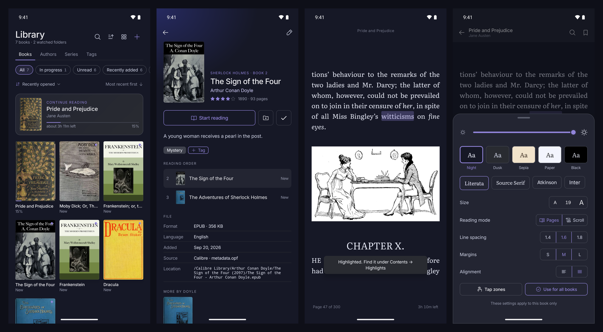

</div>

Quire reads your books where they already are. Point it at your Calibre library or any folder and it builds a library from the files and the metadata beside them, with no import step, and stays fast with thousands of books. It searches the full text of every book, and works entirely offline: the app has no network permission and no account.

- [Features](#features)
- [Screenshots](#screenshots)
- [Installation](#installation)
- [Privacy](#privacy)
- [Building from source](#building-from-source)
- [Known limitations](#known-limitations)
- [Credits](#credits) · [Licence](#licence)

## Features

### Library

- **Folders, not imports.** Watches your Calibre library, `Books`, `Downloads` or any folder you choose, and picks up new files when the app opens and every six hours in the background.
- **Calibre-aware.** Reads each book's `metadata.opf` and `cover.jpg`: series and number, tags, ratings, description and date added. Your Calibre library is never modified.
- **EPUB, MOBI and AZW3.** DRM-free Kindle books are read, searched and annotated like EPUBs. When Calibre keeps several formats, the book appears once.
- **Fast at scale.** About 100 books a second on the first scan; a rescan of 1,500 unchanged books takes half a second.
- **Browse your way.** Books, Authors (with an A–Z rail), Series (showing missing volumes) and Tags, as a grid, a list or shelves. Sort by recently opened, date added, publication date, file size or length, and filter by status, tag or word count.
- **Archive of Our Own tags.** AO3 downloads keep each tag's type: the book page groups them into rating, warnings and category, then fandoms, relationships, characters, additional tags and collections, with the work's chapters, status, dates and word count. The Tags tab is split by type, and search narrows by type with `fandom:`, `ship:`, `character:`, `tag:`, `rating:`, `warning:`, `category:` and `collection:` (quote values with spaces, e.g. `fandom:"Supergirl (TV 2015)"`).
- **Folder tags.** Every book is tagged with the folder it lives in, and the tag follows the file when it moves. Any tag can be hidden from the library without deleting anything.
- **Edit book details.** Change a book's title, authors, series and cover inside Quire, with the cover taken from your photos or from the book's own pictures. Edits survive rescans and never touch the file.
- **Bulk actions.** Select several books to share, tag, copy, remove (keeping the files) or delete them together.
- **Open from anywhere.** Quire appears in *Open with* and the share sheet for EPUB, MOBI and AZW3 files.
- **Reading stats.** Time read today, this week and this month, streaks, a 30-day chart, books finished this year and pages per hour.

### Full-text search

- **Search every book at once.** A background index groups results by book, with chapter labels and highlighted excerpts; opening a result goes straight to the passage.
- **Filter and rank.** Narrow by author, series, tag, reading status or length as you type, and order by relevance or number of matches.
- **Chinese, Japanese and Korean** text is matched character by character, alongside other scripts in the same query.
- **Considerate indexing.** Indexing pauses while you read, can be limited to charging, and resumes where it stopped. Until it finishes, the search screen shows how much of the library is covered.

### Reading

- **Accurate rendering** through the [Readium toolkit](https://github.com/readium/kotlin-toolkit): images, tables, footnotes, links and publisher CSS.
- **Pages or continuous scroll.** Scroll mode runs through the whole book as one column, with seamless chapter changes and bounded memory use.
- **Typography.** Five themes including AMOLED black, nineteen bundled reading fonts plus your own TrueType and OpenType fonts, and control over size, spacing, margins and alignment. Defaults are set once and can be overridden per book; optional advanced controls cover hyphenation, letter and word spacing, paragraph styles and more.
- **Comfort.** A brightness dimmer, a scheduled warm-light filter, a configurable status line, volume-key page turns, an orientation lock, and *Keep screen on* with an optional time limit.
- **Built-in dictionary.** Long-press an English word for its definitions, offline, from [Open English WordNet](https://github.com/globalwordnet/english-wordnet). Other languages can use any installed dictionary app.
- **Highlights, notes and bookmarks** in five colours, collected in one list. Share a passage as text or as an image card set in the book's font.
- **Read aloud** with the device's text-to-speech engine, in the book's language, with screen-off playback and lock-screen controls.
- **Auto-scroll and auto page turn** at an adjustable pace.
- **Zoomable images and tables**, full screen, up to 8×.
- **Navigation.** Contents with real page numbers, in-book search with matches underlined on the page, and a *Back to page N* chip after following a link.

### Backup

- **Reading data** (positions, ratings, tags, bookmarks, highlights, notes and reading sessions) goes with Android's own backup and can be exported to a single file that merges into any library.
- **Full backups** write the whole library, including settings, your fonts and optionally the search index, to one `.zip`, manually or on a daily or weekly schedule. See [docs/user-data-backup.md](docs/user-data-backup.md).

## Screenshots

| Welcome | Pick folders | Library ready |
|:---:|:---:|:---:|
| 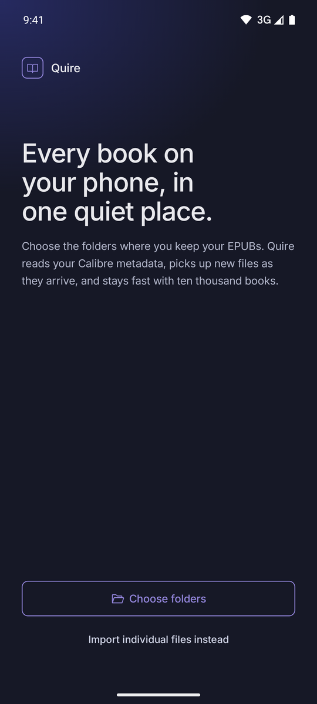 | 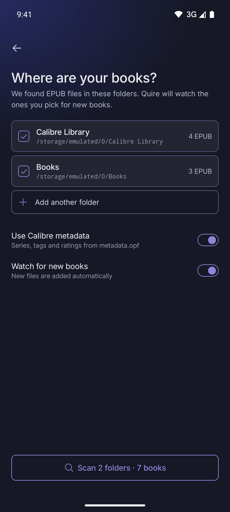 | 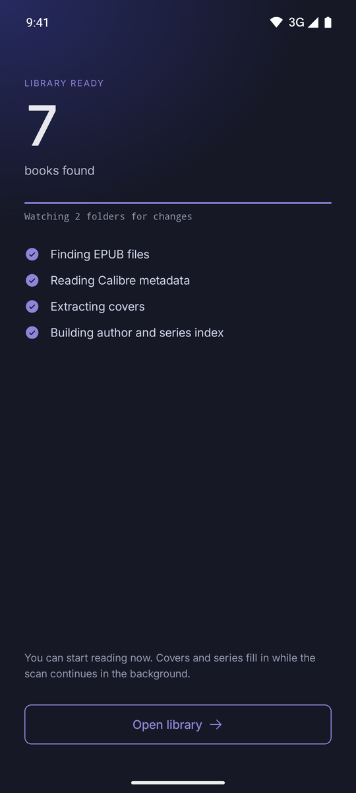 |

| Library | Shelves | Dense list |
|:---:|:---:|:---:|
| 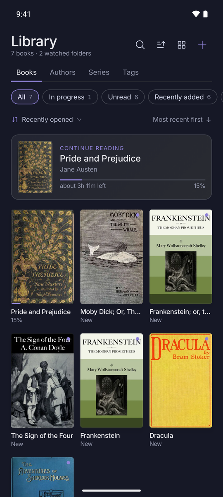 | 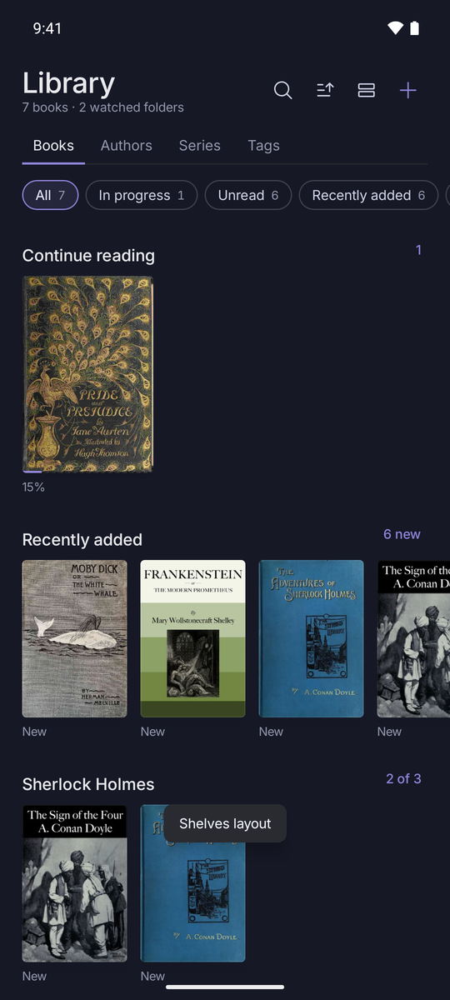 | 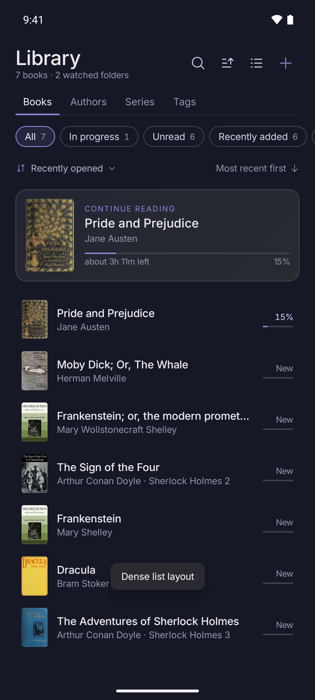 |

| Authors | Series | Tags |
|:---:|:---:|:---:|
| 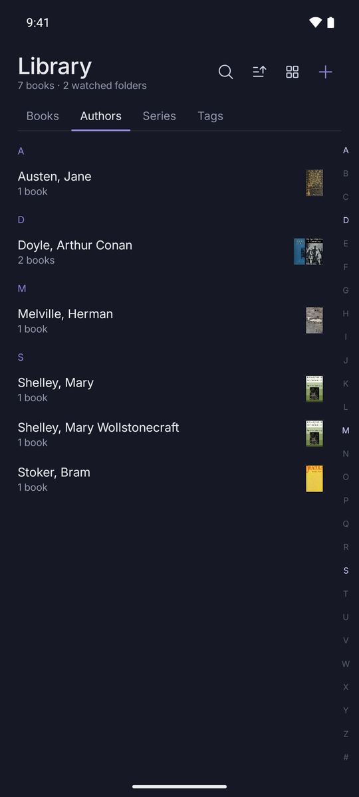 | 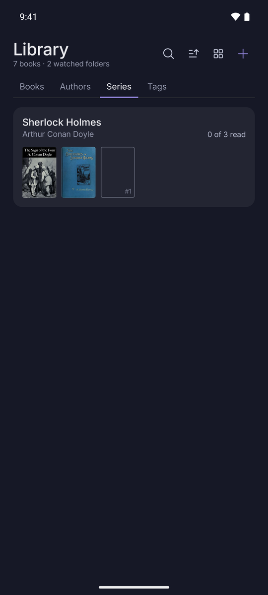 | 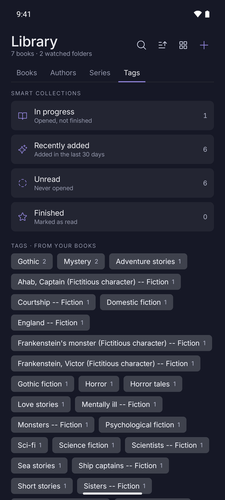 |

| Book page | Sort | Add books |
|:---:|:---:|:---:|
| 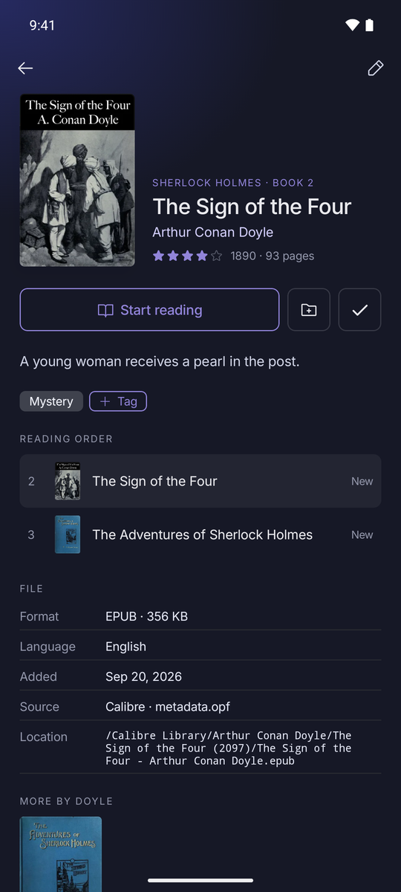 | 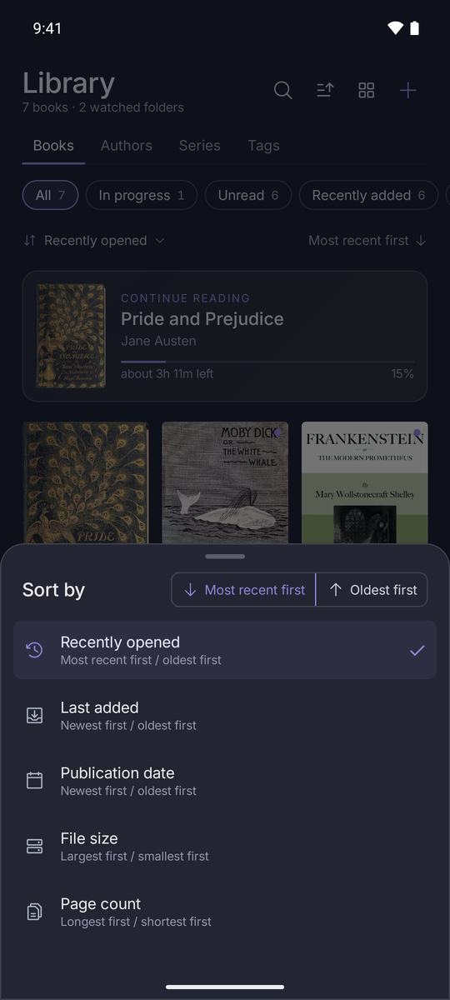 | 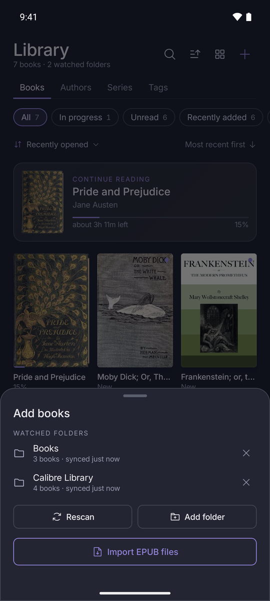 |

| Reading | AMOLED black | Display settings |
|:---:|:---:|:---:|
| 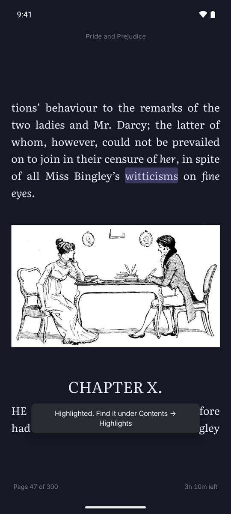 | 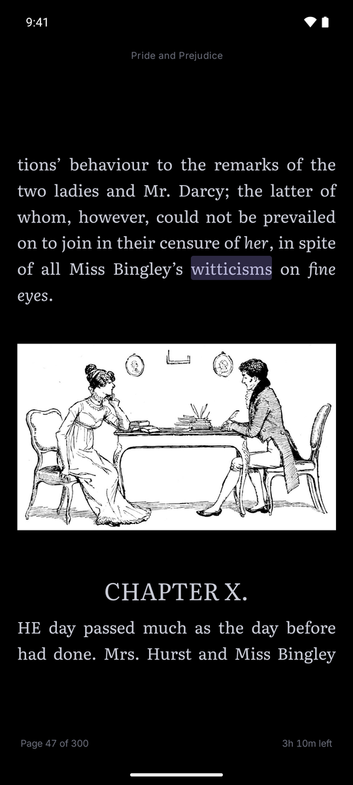 | 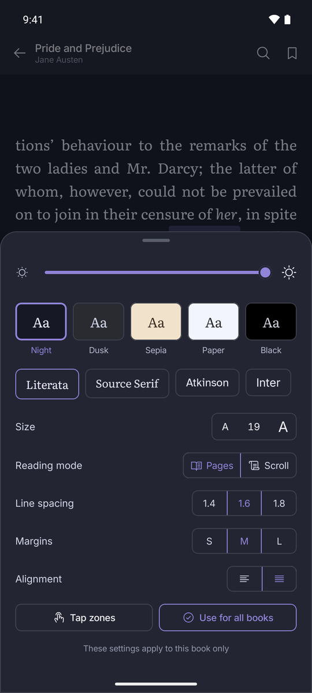 |

| Contents | Search in book | Search inside books |
|:---:|:---:|:---:|
| 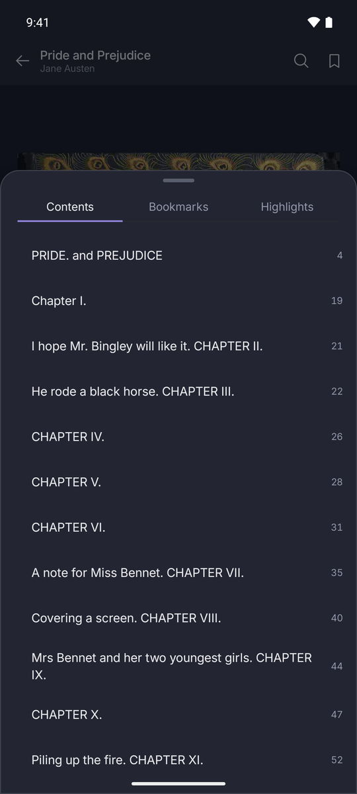 |  | 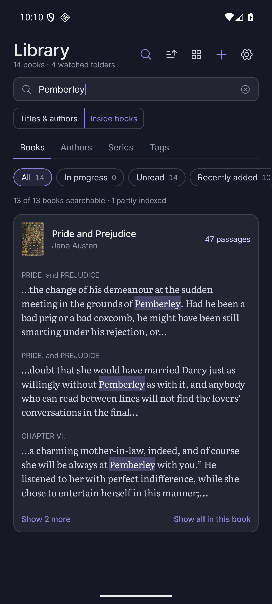 |

## Installation

Download the signed APK from the [latest release](https://github.com/sekhnat/Quire/releases/latest) and install it. Each version installs over any earlier one and keeps your library. Quire requires Android 11 or later.

Every push to `main` also produces a signed build, available as the **quire-release-apk** artifact on the [Build workflow](https://github.com/sekhnat/Quire/actions/workflows/build.yml). If you previously installed a debug build, uninstall it once before installing a signed one.

## Privacy

Quire needs **All files access**, a single switch in Android's settings, to read your library in place and notice new books. It has no network permission, no account and no analytics, so nothing leaves the device. Read aloud uses the device's own speech engine, which may download voice data independently.

## Building from source

**Requirements:** JDK 21 and the Android SDK with platform 37 and build tools 37.0.0.

```sh
./gradlew assembleDebug test lint     # build, run unit tests and lint
./gradlew installDebug                # install on a connected device or emulator
./gradlew assembleRelease             # R8-minified release build
```

Outputs land in `app/build/outputs/apk/{debug,release}/`. Release builds are signed with the key named by `QUIRE_KEYSTORE_FILE`, `QUIRE_KEYSTORE_PASSWORD`, `QUIRE_KEY_ALIAS` and `QUIRE_KEY_PASSWORD`, falling back to the debug key when those are unset. `-PversionCode` and `-PversionName` set the version (defaults `1` and `1.0`).

To try it on an emulator, grant storage access and copy some books over:

```sh
adb shell appops set com.quire.reader MANAGE_EXTERNAL_STORAGE allow
adb push my-books/ /sdcard/Books/
```

**Architecture.** Kotlin and Jetpack Compose, Room for the library, a separate FTS5 database for full-text search, and a vendored copy of Readium's EPUB navigator. [docs/architecture.md](docs/architecture.md) describes the design in detail; [navigator/VENDORED.md](app/src/main/java/com/quire/reader/navigator/VENDORED.md) lists every change from upstream Readium.

**Releasing.** Add a dated entry for the version to [CHANGELOG.md](CHANGELOG.md) on `main` (`## [1.16.0] - 2026-11-15`), then run **Actions → [Release](https://github.com/sekhnat/Quire/actions/workflows/release.yml) → Run workflow** on `main` with the version number. The workflow validates the version, tags `main`, and triggers the build that signs the APK and publishes the GitHub release. A *dry run* option performs only the checks.

## Known limitations

- Changes made in Quire (tags, ratings, edited details) are not written back to Calibre.
- DRM-protected books, including most Kindle Store purchases, cannot be opened. Formats other than EPUB, MOBI and AZW3 are not supported.
- The built-in dictionary covers English only.
- Full-text search matches phrases within a single indexed passage of about 1,500 characters, and indexes at most 6 MiB of text per book. The first indexing pass over a large library takes time (about 76 minutes for 1,500 books). See [docs/architecture.md](docs/architecture.md#library-text-search-limits-and-cost) for details.

## Credits

- [Readium](https://readium.org) for EPUB parsing and rendering
- [Open English WordNet](https://github.com/globalwordnet/english-wordnet) for the dictionary
- [Phosphor Icons](https://phosphoricons.com)
- The bundled reading fonts, under the SIL Open Font License (licences in `app/src/main/assets/licenses/fonts`; OpenDyslexic via Readium)
- Sample books from [Project Gutenberg](https://www.gutenberg.org)

The interface follows the Quire Reader design, built on the Nocturne design system.

## Licence

Quire is licensed under the [Apache License 2.0](LICENSE). It includes a modified copy of Readium's EPUB navigator (`app/src/main/java/com/quire/reader/navigator/`), which remains under Readium's [BSD 3-Clause licence](app/src/main/assets/licenses/readium-LICENSE.txt). The Phosphor icons are [MIT](app/src/main/assets/licenses/phosphor-LICENSE.txt), the reading fonts are under the SIL Open Font License 1.1, and the dictionary data is [CC BY 4.0](app/src/main/assets/licenses/open-english-wordnet-LICENSE.txt). Settings → Open-source licences lists all of these in the app.
