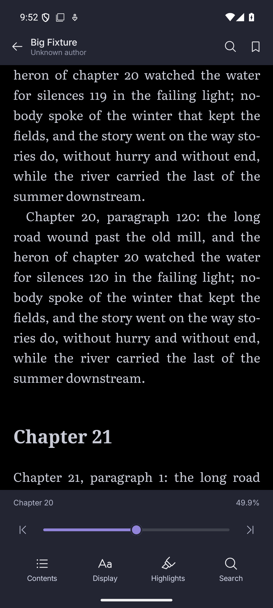
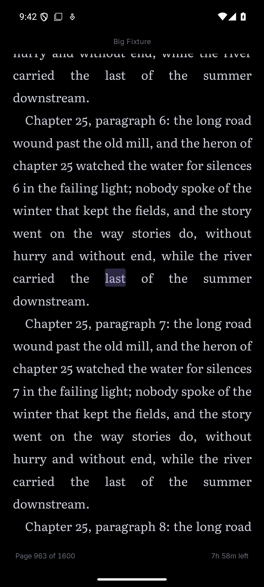
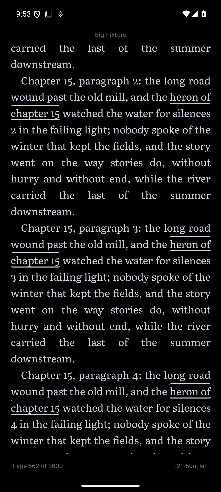
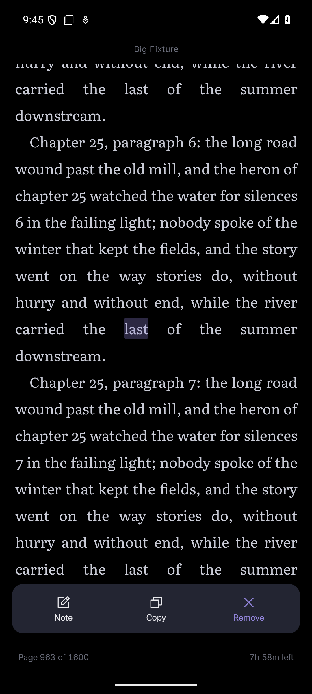
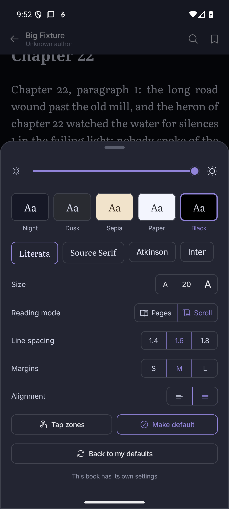
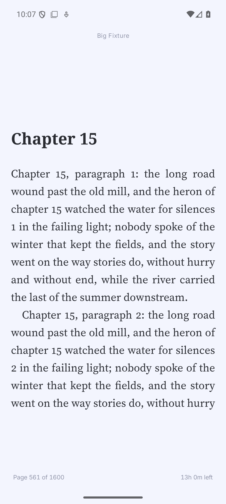

# Architecture

How Quire is put together, for contributors. For what the app does, see the [README](../README.md); for what changed, the [changelog](../CHANGELOG.md).

## Source layout

```
app/src/main/java/com/quire/reader/
├── data/
│   ├── db/        Room: books, tags, reading state, bookmarks, highlights
│   ├── index/     library text search: FTS5 chunks, CJK bigrams, background indexer, grouped search
│   ├── mobi/      MOBI and AZW3: header metadata and covers, conversion to EPUB on first open
│   ├── scan/      folder scanner, Calibre OPF parser, cover thumbnails, background worker
│   ├── LibraryRepository.kt, SettingsStore.kt, ReaderPrefs.kt
├── navigator/     vendored Readium EPUB navigator (WebView), extended for exact-passage navigation
├── reader/        Readium wrapper: session, navigator host, preferences, scroll readiness
├── theme/         Nocturne design tokens, fonts, reader themes
└── ui/            Compose screens: onboarding, library, book page, reader
```

- **Kotlin and Jetpack Compose.** `QuireViewModel` keeps only app and navigation state; each screen has its own state holder (`LibraryState`, `DetailState`, `ReaderState`, `SettingsState`, `OnboardingState`), owned by its destination and closed when you leave it.
- **Room** stores the library; sorting, filtering and grouping happen over the in-memory list, which is instant at this scale.
- **Readium 3.4** parses and renders EPUBs (it needs compileSdk 37).
- **Library text search** lives in its own database, `quire-index.db`, on the bundled SQLite (the platform's has no FTS5; the user's data stays in `quire.db` on the platform one). Each book's text is cut into chunks of 1,000–1,500 characters that never overlap: an element is split only when it alone is longer than a chunk, and the text around such a split is kept in a small `seam` table so a phrase can still cross it. Chunks sit in a plain table with a compact binary mapping (character offset and progression per source element, which is all the locator needs), and an external-content FTS5 table indexes them; chunks that contain Chinese, Japanese or Korean text also get a bigram entry in a contentless FTS5 table, since `unicode61` keeps a whole run of such characters as one token. A book owns a contiguous range of chunk ids, so a match is assigned to its book from its id alone. On the 1,500-book test library the index is about 37% of what the old FTS4 layout took, and a background WorkManager chain indexes in five-minute batches, stops while a reader is open (or on battery, if you ask it to), and a killed process resumes where it stopped.
- The EPUB navigator is vendored (a copy of Readium's, under `navigator/`) and gained `evaluateJavascript(script, href)` and `scrollToDecoration`, so a search result can be located, underlined and scrolled to exactly. [`navigator/VENDORED.md`](../app/src/main/java/com/quire/reader/navigator/VENDORED.md) lists every change from upstream and what the copy still takes from the Readium AAR; `scripts/navigator-upstream-diff.sh` regenerates the comparison for an upgrade.
- **Scroll mode is one continuous surface with a bounded live window**: `navigator/epub/ContinuousBookWebView.kt` owns a single WebView whose reserved shell document (`assets/quire/continuous-scroll.*`) holds one slot per reading-order resource, in publication order. Only the slots near the viewport hold a document (a same-origin, full-content-height iframe with its own Readium runtime); the others are empty boxes of their measured height, or of an estimate from the resource's position count until a background pass has measured them. The pass loads unmeasured chapters a couple at a time, never while you scroll, and height changes above the viewport are compensated with a scroll adjustment in the same task, so the text you are reading does not move. The surface reports ready once the documents around the starting position have settled. Each frame has its own `ScriptRunner` bound to the original href; a jump, a search underline, a script by href or a text selection pins its chapter, which loads it if needed, and a reloaded chapter re-runs the per-resource initialization (CSS, decoration templates, saved decorations). Jump targets and reflow anchors are resolved by the shell from its current heights, because the native table trails them. A killed WebView renderer no longer takes the app down, in scroll mode, paged mode, fixed layout or the image viewer: the page is rebuilt at your position.
- **Advanced reading controls** are opt-in (Settings → Advanced reading). The semantic settings live in `data/ReaderPrefs.kt` and `data/BookReaderPrefs.kt`: a per-book row carries an optional basic group and an optional advanced object, so an advanced tweak never pins the basics it inherited. They map onto Readium's preferences through the constants table in `reader/PrefsMapper.kt` (checked against the vendored editor by a test), and apply through one serialized, position-preserving pass — capture the position, apply the CSS delta once, reflow or invalidate, then restore the position (`EpubNavigatorFragment`). What each control can do to the open book is computed per submitted preferences against that same editor in `reader/ReaderPreferenceContext.kt`; candidate editors answer "would this value take effect?" without probing the navigator, so a control that can't act greys out with its reason and keeps its value.
- Locator and position formats are the same in both modes: scroll mode reports original EPUB hrefs and resource-local progression, so old bookmarks, highlights and saved positions reopen as they did.
- The scanner skips unchanged files by size and modified time, reads the rest four at a time, and never lets one broken file stop the run. A folder that has gone missing (an unmounted SD card) never removes its books from the library.

## Library text search: limits and cost

- Latin-script words match as whole indexed tokens; a prefix of a very common word falls back to the exact word, with a note.
- A phrase, or two words that must both appear, matches only within one indexed passage (about 1,000–1,500 characters, never crossing a chapter) or across the split of a single long paragraph. A phrase that starts at the end of one paragraph and ends at the start of the next can be missed when the two fall in different passages.
- Counts are exact up to 50,000 passages and then read "N+".
- A book whose text passes 6 MiB is only partly indexed. A book with chapters that cannot be read (a damaged file) is indexed without them and shown as partly indexed.
- The first pass over 1,500 books takes about 76 minutes on the test emulator, almost all of it reading the EPUBs. The index is about 1.6 times the size of the text it covers (1.6 GB for 1,500 books).
- Settings → Rebuild index re-indexes the library from scratch. Indexes built before self-closing `<title/>` tags were handled, or inside the library database by older versions, are rebuilt this way.

## Scroll mode in pictures

A 550-chapter, 90 MB book opens in about a third of a second and stays around 400–500 MB of renderer memory however far you read.

| Chapter seam | Highlight | Search hit |
|:---:|:---:|:---:|
|  |  |  |

| Highlight actions | Reflow keeps the place | Paged mode after switching |
|:---:|:---:|:---:|
|  |  |  |
